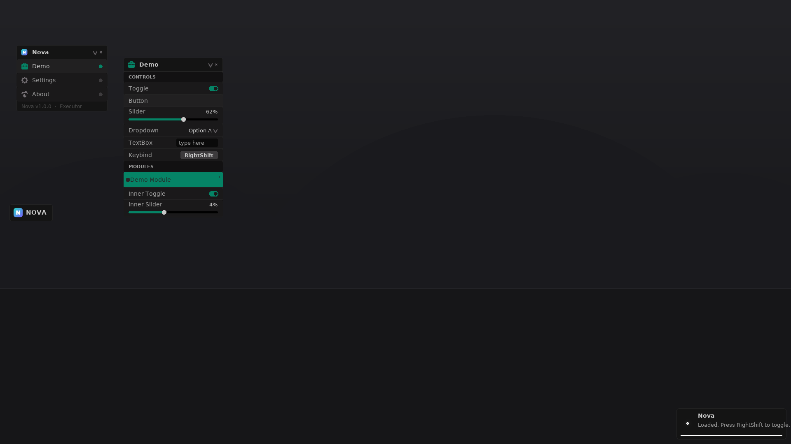

# Nova GUI · 罗布乐思客户端脚本 UI 库

暗色 + 细描边 + 像素小圆角 + **长方形悬浮球** + **多窗口** 的脚本界面库，风格参考
[Vape V4](https://github.com/7GrandDadPGN/VapeV4ForRoblox)，但代码是从零写的，并且把
「所有控件随屏幕大小按百分比缩放」做成了核心机制（Vape 是固定像素 + 整体 UIScale）。

预览图（用库里的真实配色、真实尺寸、真实图标渲染的，不是手绘）：



---

## 一、直接用

执行器里粘一行：

```lua
loadstring(game:HttpGet('https://raw.githubusercontent.com/aa121314aa/idkidk/main/src/Nova.lua', true))()
```

第一次执行会看到悬浮球 + 主窗口。默认是 **没有功能模块** 的（库只管界面），
想看控件长什么样，再加一行示例：

```lua
loadstring(game:HttpGet('https://raw.githubusercontent.com/aa121314aa/idkidk/main/src/Example.lua', true))()
```

写自己的模块：

```lua
local Nova = getgenv().Nova

local win = Nova:CreateWindow({Name = '我的窗口', Icon = 'icon_wrench', Visible = true})

win:AddSection({Name = '分组'})
win:AddToggle({Name = '开关', Default = false, Callback = function(value) print(value) end})
win:AddSlider({Name = '数值', Min = 0, Max = 100, Default = 50, Suffix = '%', Callback = print})

-- 模块 = 带开关 + 可展开选项（Vape 那种）
local mod = win:AddModule({Name = '我的模块', Callback = function(on) print(on) end})
mod:AddToggle({Name = '模块内开关', Default = true})
mod:AddDropdown({Name = '模块内下拉', List = {'A', 'B', 'C'}, Default = 'A'})
```

> 未合并的分支上测试：把 URL 里的 `main` 换成 `arena/07d79b1f-idkidk`，
> 或者执行 `Nova.Assets:SetRef('arena/07d79b1f-idkidk')` 后再 `Nova.Assets:Prefetch()`。

---

## 二、目录结构

```
assets/            图标资源（PNG，直接换图就能改外观）
preview/           UI 预览图（tools/preview.py 生成）
src/
  Nova.lua         单文件成品（执行器实际加载的就是它，由 tools/build.py 生成）
  Example.lua      示例模块 / 写模块的模板
  Loader.lua       一行加载器
  library/         源码，按模块拆分
    00_Core.lua      库表 / 版本
    01_Env.lua       执行器适配层（能力检测、HTTP、文件、挂载点）
    02_Scale.lua     百分比缩放系统
    03_Theme.lua     配色 / 字体 / 圆角 / 强调色
    04_Assets.lua    资源加载（下载 + getcustomasset，rbxassetid 回退）
    05_Util.lua      圆角 / 描边 / 阴影 / 拖拽 / 提示气泡
    06_Ball.lua      悬浮球
    07_Window.lua    多窗口系统 + 主窗口(窗口列表)
    08_Widgets.lua   控件：分区/标签/开关/按钮/滑块/下拉/输入框/按键绑定/模块
    09_Notify.lua    右下角通知
    10_Init.lua      组装 + 按键 + 配置存取
tools/
  build.py         把 library/ 拼成 src/Nova.lua
  mocktest.py      在模拟 Roblox 环境里跑一遍（lupa），抓运行时错误
  mock_roblox.lua  模拟的 Roblox API
  preview.py       渲染 UI 预览图（Pillow）
```

改动 `library/` 里任意文件后，跑一次 `python3 tools/build.py` 重新生成 `src/Nova.lua`。

---

## 三、三件核心事

### 1. 悬浮球

```lua
Nova:CreateBall({Width = 104, Height = 40, Corner = 4, X = 0.012, Y = 0.46, Text = 'NOVA'})
```

- **长方形**（104×40 设计像素），圆角是**像素值** `UDim.new(0, 4)`，不随屏幕缩放 —— 就是你要的「像素圆角、数值不大」
- 拖动松手后**自动吸附到屏幕左右边缘**（`Ball.Snap = false` 可关）
- **单击**开关整个界面；**拖动过就不算点击**（位移 < 5px 才算点击）；**右键**一次性收起/展开所有窗口
- 界面打开时描边变成强调色
- 位置按**屏幕比例**保存，换分辨率不跑偏

### 2. 多窗口

- 每个窗口独立：可拖动、可折叠、可单独关闭，互不影响
- 主窗口（左上）列出所有窗口，点一下开关对应窗口，右侧小圆点表示是否显示
- `Nova:CreateWindow({...})` 建的窗口默认都会进主窗口列表（`ShowInList = false` 可排除）
- 窗口高度 = 标题栏 + 内容，超过屏幕 78%（`MaxHeight` 可改）之后变滚动

### 3. 百分比缩放

库里所有尺寸都用**设计像素**描述（基准 1920×1080），由 `02_Scale.lua` 换算：

| 模式 | 行为 |
| --- | --- |
| `Percent`（默认） | 宽度按屏幕宽度的百分比、高度按屏幕高度的百分比，真正的百分比布局 |
| `Uniform` | 整体等比缩放（Vape 的做法），不会被屏幕比例拉伸 |

```lua
Nova.Scale:SetMode('Uniform')
```

- 屏幕大小一变（改分辨率/窗口化），所有登记过的尺寸、字号、描边、内边距自动重算
- 窗口位置存的是比例，缩放后位置跟着走，不会跑出屏幕
- 字号用等比系数并做了 `MinScale 0.6 / MaxScale 2.5` 保护，小屏上不会糊成一团
- 圆角保持像素值不变

---

## 四、API

### 库

| 方法 | 说明 |
| --- | --- |
| `Nova:Init(props)` | 手动初始化（默认自动执行；`getgenv().NovaNoAutoInit = true` 可关） |
| `Nova:CreateWindow(props)` | 建窗口 |
| `Nova:CreateMainWindow(props)` | 建主窗口（Init 里已建好，一般不用调） |
| `Nova:CreateBall(props)` | 建/重建悬浮球 |
| `Nova:SetVisible(bool)` / `Nova:ToggleGUI()` | 开关界面 |
| `Nova:SetToggleKey(Enum.KeyCode.X)` | 改开关按键（默认 `RightShift`） |
| `Nova:Notify(title, text, duration, kind)` | 通知，`kind` = `info`/`warning`/`alert` |
| `Nova:Save()` / `Nova:Load()` | 手动存取配置（窗口位置/折叠状态/主题色/缩放模式） |
| `Nova:Destroy()` | 全部清理 |
| `Nova.Scale` / `Nova.Theme` / `Nova.Assets` / `Nova.Env` | 子系统 |

### 窗口

```lua
window:SetVisible(v)  window:Toggle()  window:SetCollapsed(v)
window:SetName(name)  window:Clear()   window:Destroy()
window.Widgets        -- 所有控件
```

### 控件

| 方法 | 返回对象的常用字段 |
| --- | --- |
| `AddSection({Name})` | `SetName` |
| `AddLabel({Text})` | `SetText` |
| `AddToggle({Name, Default, Callback, Tooltip})` | `:SetEnabled(v)` `:Toggle()` `.Enabled` |
| `AddButton({Name, Callback})` | `:Fire()` |
| `AddSlider({Name, Min, Max, Default, Decimals, Suffix, Callback})` | `:SetValue(v)` `.Value` |
| `AddDropdown({Name, List, Default, Callback})` | `:SetValue(v)` `:SetList(list)` `:SetOpen(b)` |
| `AddTextBox({Name, Placeholder, Default, Callback})` | `:SetValue(v)` `.Value` |
| `AddKeybind({Name, Default, Callback})` | `:SetValue(key)` |
| `AddModule({Name, Callback, Tooltip})` | `:SetEnabled(v)` `:SetOpen(b)` + 里面继续 `Add*` |

所有控件都有 `SetVisible(bool)`；选项都支持 `Tooltip`（鼠标悬停小气泡）。

### 主题

```lua
Nova.Theme.Main      -- 背景色
Nova.Theme.Text      -- 文字色
Nova.Theme.Corner    -- 圆角像素值（默认 4）
Nova.Theme:SetAccent(hue, sat, val)   -- 强调色
Nova.Theme:SetFont(obj, semiBold)
```

---

## 五、执行器适配

`01_Env.lua` 里做了能力检测，缺什么就退化，不会直接报错：

- **挂载点**：`gethui()` → `CoreGui` → `PlayerGui`（并调用 `protect_gui`）
- **HTTP**：`game:HttpGet` → `request`/`syn.request`/`http_request`
- **资源**：有 `writefile` + `getcustomasset` 就把 PNG 下载到本地再加载；没有就回退到 `rbxassetid`
- **文件**：没有文件函数时，配置存取静默跳过（界面照常能用）
- **线程**：有 `setthreadidentity` 就用（部分执行器需要 identity 8）
- `cloneref` / `identifyexecutor` 等都是可选调用

已在模拟环境里跑过 `Percent`/`Uniform`、有无文件权限两种组合（`tools/mocktest.py`）。

---

## 六、资源（assets/）

- 图标来自 [Vape V4](https://github.com/7GrandDadPGN/VapeV4ForRoblox)（**CC0-1.0**），路径到 `rbxassetid` 的映射表见 `04_Assets.lua`
- `logo.png` / `logo_small.png` / `logo_tiny.png` 是本仓库自制的品牌图标（青→紫渐变圆角方块 + N 字形）
- **换图 = 直接替换 `assets/` 里的同名 PNG**，不用改代码
- 加新图标：丢进 `assets/`，然后 `Nova.Assets:Prefetch({'我的图标'})`；想让没有文件权限的执行器也能看到，
  就把它上传到 Roblox 拿到 id，写进 `Nova.Assets.Ids['我的图标'] = 数字`

---

## 七、开发 / 自测

```bash
python3 tools/build.py                 # 重新生成 src/Nova.lua
pip install lupa pillow
python3 tools/mocktest.py              # 模拟 Roblox 跑一遍（含存档往返、拖拽、缩放、资产回退）
python3 tools/preview.py               # 重新生成 UI 预览图
```

`mocktest.py` 会在两套环境里跑完整流程并断言：控件创建、点击/拖拽事件、
屏幕缩放后的尺寸与位置、缩放模式切换、配置存取往返、资源回退、销毁清理。
有拼错的属性名或 nil 调用会直接报出来。

---

## 八、接下来可以做的（等你点单）

1. **配色/主题面板**：把 `Theme` 里的颜色做成可调（深浅主题、自定义强调色 + 保存）
2. **搜索框**：Vape 那种顶部搜索，输入即过滤模块名
3. **颜色选择器**（Hue 条 + 饱和度方块），给模块做自定义颜色
4. **配置存档分游戏**：现在是一份 `nova/config.json`，可以按 `GameId/PlaceId` 分开存
5. **窗口可缩放**：右下角拖拽改大小（宽度已经是百分比，做起来不难）
6. **TextGUI / 目标信息** 这类 HUD 覆盖层（Vape 的 Overlay 体系）
7. **窗口排序 / 分组嵌套**：目前是平铺列表，可以做可折叠分组
8. **移动端**：触摸已经能拖动，但小屏建议 `Scale:SetMode('Uniform')` + 更大的行高

---

## 许可

代码部分随意使用；`assets/` 里的图标来自 Vape V4（CC0-1.0），自制 logo 同样 CC0。
